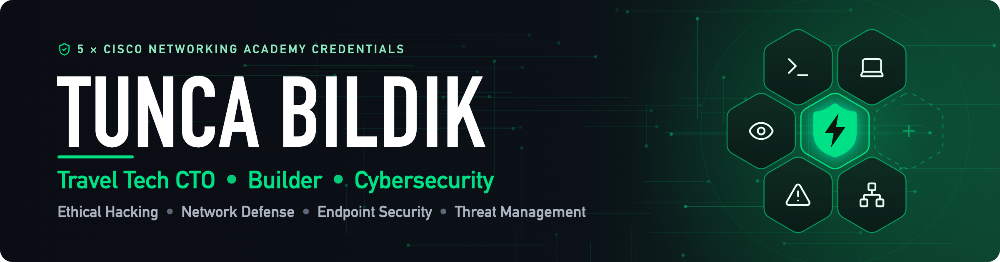

  

  

  
I'm a travel-tech entrepreneur who writes the software behind the business — booking engines, supplier panels, pricing automation and WhatsApp bots. On the side I build hardware and apps: <strong>Pervane</strong>, an open-source fan controller for macOS, <strong>real Android in the Tesla browser</strong> on a Raspberry Pi 5, a toolkit that lets <strong>Claude Code drive a real iPhone</strong>, a <strong>camera-free Wi-Fi presence sensor</strong> for Apple Home on ESP32-C6, an open-source <strong>Tesla CAN-bus mod</strong>, a Bluetooth EV dashboard for iOS, <strong>Rendi</strong> — a Turkish dating app launching on iOS and Android — and a Turkish EV channel that answers one question with real numbers: <em>should I go electric?</em>

  
🇹🇷 Seyahat teknolojisi alanında girişimciyim; işi çalıştıran yazılımı kendim yazıyorum: rezervasyon motoru, tedarikçi paneli, fiyat otomasyonu, WhatsApp botları. Yanında donanım ve uygulama geliştiriyorum: macOS için açık kaynak fan kontrolü <a href="https://github.com/tuncasoftbildik/pervane">Pervane</a>, Raspberry Pi 5 ile Tesla tarayıcısında gerçek Android, Claude Code'a gerçek iPhone'u kullandıran araç seti, ESP32-C6 ile Apple Home'a kamerasız Wi-Fi varlık sensörü, açık kaynak Tesla CAN modu, iOS için Bluetooth EV göstergesi, iOS ve Android'de yayına hazırlanan flört uygulaması <a href="https://rendi.com.tr">Rendi</a> ve gerçek rakamlarla "elektrikliye geçmeli miyim?" sorusuna cevap veren <a href="https://youtube.com/@yakitsiz">Yakıtsız</a> kanalı.

 

  
  
  
  

 

  <h2>Certifications</h2>
  
  
  
  
  
  
<strong>Cisco Junior Cybersecurity Analyst Career Path</strong> · <strong>Cisco Ethical Hacker</strong> · <strong>Cisco Endpoint Security</strong> · <strong>Cisco Cyber Threat Management</strong> · <strong>Cisco Network Defense</strong> · Cisco Networking Academy · Nov 2026 
  Penetration testing · Vulnerability assessment · Social engineering · Endpoint & host protection · Threat intelligence · Risk management · Digital forensics & incident response · Firewalls & ACLs · Cloud security · Cryptography

 

  <h2>Featured Projects</h2>

<table align="center">
  <tr>
    <td align="center" colspan="2" valign="top">
      <h3>🌀 <a href="https://github.com/tuncasoftbildik/pervane">Pervane</a> new</h3>
      
      
Open-source <strong>fan control for macOS</strong>: drag a temperature curve, switch profiles automatically when an app starts or you go on battery, and let an <strong>emergency brake</strong> take over when it gets too hot. Menu bar app + CLI, no dependencies.

      

        
        
        
        
      

      <code>curves · auto-switch rules · CLI</code>
    </td>
  </tr>
  <tr>
    <td align="center" width="50%" valign="top">
      <h3>🚗 <a href="https://github.com/tuncasoftbildik/tesla-android-pi5">Android in a Tesla</a></h3>
      
Real <strong>Android 13</strong> in the Tesla browser, running on a <strong>Raspberry Pi 5</strong> with Waydroid — touch, audio and GPS, and it keeps working while driving. Patched ws-scrcpy, a password gate and a Cloudflare tunnel.

      

        
        
        
      

      <code>720p · 30 fps · WebCodecs</code>
    </td>
    <td align="center" width="50%" valign="top">
      <h3>🤖 <a href="https://github.com/tuncasoftbildik/iphone-claude-code">iPhone × Claude Code</a></h3>
      
Let <strong>Claude Code</strong> use your real iPhone, wirelessly — it sees the screen, taps, swipes and types through <strong>WebDriverAgent</strong>. Test your own apps end to end or grab App Store screenshots.

      

        
        
        
      

      <code>no cable, real device</code>
    </td>
  </tr>
  <tr>
    <td align="center" width="50%" valign="top">
      <h3>📡 <a href="https://github.com/tuncasoftbildik/esp32c6-wifi-csi-apple-home">Wi-Fi CSI Presence</a></h3>
      
Turn a cheap <strong>ESP32-C6</strong> into a camera-free occupancy sensor that shows up natively in <strong>Apple Home</strong> over Matter — it senses people from how they disturb Wi-Fi, so it also detects someone sitting still.

      

        
        
        
      

      <code>~900× idle / walking separation</code>
    </td>
    <td align="center" width="50%" valign="top">
      <h3>⚡ <a href="https://github.com/tuncasoftbildik/tesla-can-mod">TeslaCAN</a></h3>
      
Open-source Tesla Model 3 / Y CAN-bus mod for the <strong>ESP32-C6</strong> — FSD activation, battery telemetry, preconditioning, built-in LCD, WiFi dashboard and a Flipper Zero companion app.

      

        
        
        
      

      <code>pio run -t upload</code>
    </td>
  </tr>
  <tr>
    <td align="center" width="50%" valign="top">
      <h3>💬 <a href="https://rendi.com.tr">Rendi</a></h3>
      
A Turkish dating app built around <strong>control and safety</strong> — you decide who reaches you. React Native + Expo on a self-hosted Supabase stack.

      

        
        
        
      

      <code>rendi.com.tr</code>
    </td>
    <td align="center" width="50%" valign="top">
      <h3>📱 <a href="https://github.com/tuncasoftbildik/kadra-site">Kadra</a></h3>
      
iOS dashboard for your EV over <strong>Bluetooth LE</strong> — live speed, battery, range and trip data. No server, no account, on-device only. SwiftUI + StoreKit.

      

        
        
        
      

      <code>Coming to the App Store</code>
    </td>
  </tr>
</table>

 

  <h2>Languages & Tools</h2>
  

